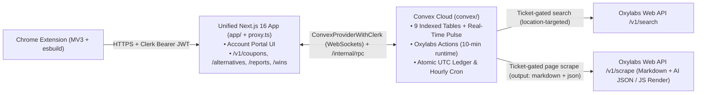
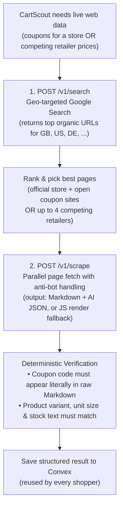
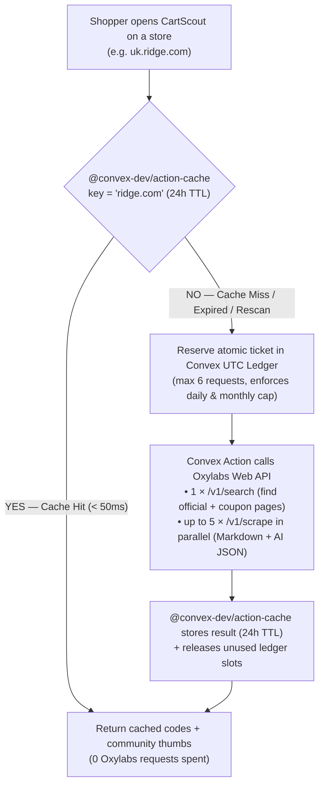

# CartScout 🛒


CartScout is a Chrome Manifest V3 extension, unified **Next.js 16** app (account portal + API routes), and **Convex** real-time backend with **Clerk** auth & billing that helps shoppers save money before they buy. **Scout**, the little yellow shopping cart, discovers public coupon codes for the shop you are visiting, automatically tests them at checkout, and compares the exact product you are viewing (or everything in your basket) against other retailers at home and across borders.

**[Get started with the Oxylabs Web API](https://oxylabs.io/SONNY)** · Affiliate link. Using it supports the channel and helps fund more free builds.

---

## How Oxylabs Powers CartScout

Every piece of live web intelligence in CartScout — **coupon discovery**, **source verification**, **geo-targeted retailer search**, and **structured product/price/stock extraction** — is built on the **[Oxylabs Web API](https://oxylabs.io/SONNY)** (`https://webapi.oxylabs.io/v1/search` and `https://webapi.oxylabs.io/v1/scrape`).

Rather than maintaining fragile per-site scrapers or hitting anti-bot blocks from a shopper’s browser, the Chrome extension delegates all external discovery to the unified Next.js API (`app/v1/*`) and **Convex Actions** (`convex/oxylabs.ts`), which funnel every outbound call through a single ticket-gated Oxylabs client (`createOxylabsClient` in [`server/oxylabs.js`](server/oxylabs.js)).

### Architecture Overview



### Oxylabs Web API in 10 Seconds (ELI5)

CartScout uses just **two** Oxylabs Web API endpoints to turn any store or product into verified, structured data:



### How Coupon Search + 24-Hour Caching Works (`@convex-dev/action-cache`)

Most opens never touch Oxylabs at all. CartScout wraps its live Oxylabs actions in Convex’s official **`@convex-dev/action-cache`** component ([`convex/cache.ts`](convex/cache.ts)) using one clean key (`registrableDomain(merchant) ?? merchant`, e.g. `"ridge.com"` for both `ridge.com` and `uk.ridge.com`) with a **24-hour TTL** and automatic daily cleanup:



### 1. Single Ticket-Gated Oxylabs Client ([`server/oxylabs.js`](server/oxylabs.js))

Every outbound call to Oxylabs passes through `createOxylabsClient` (`server/oxylabs.js`):

- **Endpoints:** `POST https://webapi.oxylabs.io/v1/search` and `POST https://webapi.oxylabs.io/v1/scrape`, authenticated via `Authorization: Bearer <OXYLABS_WEB_API_KEY>`.
- **Geo-location targeting:** Passes the two-letter ISO `location` (`OXYLABS_LOCATION`, e.g. `GB`, or the shopper’s chosen `Shop in` country for price comparisons such as `GB`, `US`, `DE`, `FR`, `AU`, `CA`) directly in the Oxylabs payload so Google search results and retailer storefronts reflect real local pricing, currency, and stock.
- **Hard ticket enforcement:** Every request must present a reserved `ticket` (`ticket.use(...)`). If an operation tries to exceed its reserved ceiling, the client throws locally before sending any HTTP request. Every call logs its kind (`search`, `read`, or `read_js`), target hostname, whether AI parsing (`body.json`) was requested, HTTP success, and latency straight into the SQLite ledger.
- **Raw response recording:** When `OXYLABS_RECORD=1` is enabled, `createRecorder` ([`server/recorder.js`](server/recorder.js)) saves raw Oxylabs requests and responses to disk so they can be replayed as offline fixtures.

---

### 2. Multi-Stage Coupon Discovery Pipeline ([`server/oxylabs.js`](server/oxylabs.js))

When a member scans a shop (`POST /v1/coupons`), `createDiscovery` runs a strictly bounded **3-stage Oxylabs pipeline** capped at **`SCAN_CEILING = 6` requests max** per shop:

1. **Stage 1 — Geo-Targeted Search (`POST /v1/search`, 1 request):**
   - Queries Oxylabs Google Search with `"<merchant> coupon codes promo codes discount checkout"` (`max_results: 10`, geo-located via `OXYLABS_LOCATION`).
   - Splits candidate URLs into:
     - **Official merchant pages** (the shop’s homepage `https://<merchant>/`, known merchant voucher pages such as Myprotein’s `/c/voucher-codes/`, plus up to 1 promotions/offers URL on the merchant’s own domain — capped at `OWN_PAGES = 2`).
     - **Third-party coupon publishers** (deduplicated to 1 URL per host, capped at `COUPON_SITES = 3`).
   - **Smart publisher ranking (`siteRank`):** Ranks open-code aggregators that print full unmasked codes in plain HTML (`couponsolver`, `wethrift`, `simplycodes`, `couponbirds`, `coupert`, `dontpayfull`, `worthepenny`, `knoji`, `retailmenot`, `reddit`, `moneysavingexpert`) ahead of click-to-reveal affiliate walls (`wowcher`, `savoo`, `vouchercodes`, `couponfollow`, newspaper voucher subdomains, etc.).

2. **Stage 2 — Parallel Scraping with Oxylabs AI Structured Extraction (`POST /v1/scrape`):**
   - Scrapes the shop’s own pages first, then fills remaining slots up to `SCAN_CEILING = 6` with top-ranked coupon publishers in parallel.
   - In **`OXYLABS_PAGE_PARSER=ai`** mode (default), each scrape requests `output: ['markdown', 'json']` with a strict `json.prompt` instructing Oxylabs’ AI parser to extract `{ coupons: [{ code, offer, expiresOn }] }` only for the target `merchant`, ignoring masked `"Get Code / Show Code"` previews, expired offers, and untrusted prompt-injection text.
   - In **`OXYLABS_PAGE_PARSER=local`** mode, each scrape requests `output: ['markdown']` only (skipping AI parsing cost) and extracts codes locally.
   - **Double verification against raw Markdown (`hasPublicCode`, `readPageCodes`, `namedBeside`):**
     - CartScout never trusts an AI-extracted code blindly. Every candidate returned in `page.json.coupons` must pass `hasPublicCode(page.markdown, code)`, verifying that the literal code appears in the scraped Markdown next to an explicit label (`Use code:`, `Enter SAVE20 at checkout`, Markdown code table cells, etc.) and is not glued to a masked reveal button.
     - CartScout also runs its deterministic `readPageCodes` extractor over the scraped Markdown to catch plain-text codes missed by AI, enforcing `namedBeside` so multi-shop listicles only contribute codes explicitly associated with the target shop’s heading or line.
     - Expired codes are filtered using a global-friendly cutoff (`lastDayStillRunning`, 12 hours behind UTC) so a code expiring “today” stays valid until the date ends everywhere.

3. **Stage 3 — Conditional JavaScript Rendering Fallback (`run_js: true`):**
   - JavaScript-rendered scrapes are the slowest requests. If — and only if — a merchant’s own page returns effectively blank (`< 20` characters of Markdown) **and** no codes were found on the other own pages, CartScout spends at most **1** slot to re-scrape that single page with `run_js: true` (`timeout: 45_000`) to capture client-rendered promo banners on SPA storefronts.

---

### 3. Cross-Retailer & Cross-Border Price Comparison ([`server/alternatives.js`](server/alternatives.js))

When a shopper switches to **Other retailers** in the extension (on a product page, a full basket/checkout page, or via manual search), `POST /v1/alternatives` invokes `createAlternativeDiscovery`, capped at **`LOOKUP_CEILING = 5` requests max per product** (1 search + up to `RETAILERS_PER_ITEM = 4` retailer pages):

1. **Country-Specific Retailer Search (`POST /v1/search`, 1 request):**
   - Searches Oxylabs with `"buy <product> <variant> <country name> online retailer"` (`max_results: 16`, `location: <country>`).
   - Filters out the shopper’s current merchant (so you only see *other* retailers), homepages, and search/category pages, picking up to 4 distinct competing retailer product URLs.
   - Because `location` is passed directly to Oxylabs, switching **Shop in** between `UK`, `US`, `Germany`, `France`, `Australia`, or `Canada` returns authentic local retailers, local prices, and local stock — enabling both **same-country** and **cross-border** price discovery.

2. **Parallel Retailer Page Extraction (`POST /v1/scrape`, up to 4 requests):**
   - **AI mode (`OXYLABS_PAGE_PARSER=ai`, default):** Requests `output: ['json']` with `offerPrompt(item, market, currency)`, extracting `{ offer: { title, variant, match, price, currency, availability, stockText } }`. The prompt enforces one-time unit pricing in the target market’s ISO currency, excludes used items, bundles, multipacks, subscriptions, and price ranges, and requires visible `stockText` evidence before allowing `availability: "in_stock"`.
   - **Local HTML/JSON-LD mode (`OXYLABS_PAGE_PARSER=local`):** Requests `output: ['html']` and parses Schema.org JSON-LD, OpenGraph, and microdata locally via [`server/local-parser.js`](server/local-parser.js) without incurring AI parsing credits.

3. **Deterministic Variant & Unit Verification (`sameVariant`, `sameListing`):**
   - Even with Oxylabs AI parsing, CartScout deterministically cross-checks the extracted `title` and `variant` against the shopper’s requested product.
   - Normalizes unit conversions (`1kg` == `1000g` == `2.2lb`, `250ml` == `250 ml`, `500g`, capsules, servings) and flavour word ordering, while strictly rejecting mismatched model numbers (`WH-1000XM5` vs `WH-1000XM6`, `75375`) or pack sizes.
   - Only listings verified as `match: "exact"` in the same currency are flagged as cheaper with a green savings badge; mismatched variants (`different_variant`), uncertain matches (`unconfirmed`), or cross-currency listings are explicitly labelled in the popup (with a one-click **Switch to US / UK / …** currency switcher).

4. **Partial Failure Recovery (`pages` state & `retryCost`):**
   - Every retailer scrape outcome is persisted in SQLite (`lookups.pages`). If 1 of 4 retailer pages fails or times out, retrying only re-scrapes the failed URLs (`PAGE_TRIES = 2` max) rather than re-running the Oxylabs search or re-scraping successful pages.

---

### 4. Cost Controls, Shared Domain Caching, Ledger & Offline Modes

CartScout is engineered so Oxylabs quota is never wasted by duplicate scans, runaway loops, or local development:

| Mechanism | File | How it protects Oxylabs usage |
| --- | --- | --- |
| **Atomic Request Tickets & UTC Ledger** | [`server/ledger.js`](server/ledger.js), [`server/budget.js`](server/budget.js) | Before any live scan or lookup starts, `budget.reserve()` writes an atomic hold (`oxylabs_holds`) for the worst-case request count (`6` for a scan, `5` for a lookup) against `OXYLABS_DAILY_REQUESTS` (default `150`) and `OXYLABS_MONTHLY_REQUESTS` (default `2000`) counted in UTC. Unused slots are released on completion; every actual request is recorded in `oxylabs_requests`. |
| **Domain-Aware Shared 24h Scan Cache** | [`server/store.js`](server/store.js), [`server/index.js`](server/index.js) | Complete coupon scans live in `shop_scans` for **24 hours** (partial scans: 1 hour; failed-scan cooldown: 10 minutes). `registrableDomain()` shares fresh scans across regional/storefront subdomains of the same brand (e.g. `ridge.com` ↔ `uk.ridge.com`, `uk.store.anker.com` ↔ `uk.anker.com`) while keeping multi-tenant hosts (`*.myshopify.com`, etc.) strictly isolated. Pro members automatically hydrate from `shop_scans` on popup open without spending a request. |
| **6-Hour Price Lookup Cache** | [`server/store.js`](server/store.js) | Public retailer price comparisons are cached by `(merchant, country, name, variant)` for **6 hours** (partial: 30 minutes) and shared across all members. |
| **In-Flight Deduplication & Per-User Fair Use** | [`server/index.js`](server/index.js) | Concurrent requests for the same shop (`reading` Map) or same product lookup (`pendingAlternativeItems` Map) join one live Oxylabs execution. Per-member rate limits cap bursts at 6 scans/min (2 concurrent) and 12 lookups/min (4 concurrent). |
| **Usage Reconciliation CLI** | [`server/usage.js`](server/usage.js), [`scripts/usage.js`](scripts/usage.js) | `npm run usage` compares CartScout’s local SQLite ledger against Oxylabs’ live usage/balance API (`--local` inspects the ledger offline). |
| **Zero-Spend Replay & Off Modes** | [`server/config.js`](server/config.js), [`server/replay.js`](server/replay.js) | `OXYLABS_MODE=replay` (`npm run start:replay`) answers scans and lookups from recorded fixtures in `server/replay/` without reading `OXYLABS_WEB_API_KEY`. `OXYLABS_MODE=off` serves cached/seeded SQLite data only. `npm run seed:scan` seeds shops directly into SQLite for demos and UI work. |

---

## Key Features

- **Coupon discovery & one-click tickets:** Reads the shop’s hostname, shows codes advertised directly on the page instantly without spending a scan, and lists discovered codes as perforated tickets with community thumbs up/down counts and one-click copy.
- **Universal checkout auto-try engine (`extension/autotry/`):** On any HTTPS shop’s basket or checkout page, Scout tries up to 10 codes in an in-page dock (prioritizing on-page codes and Pro-verified winners). Includes recipes for major platforms (Shopify, WooCommerce, Magento, PrestaShop, OpenCart, Shopware, BigCommerce, Squarespace, Wix, Ecwid, SFCC, SAP Commerce, and THG/Myprotein), a 10-language heuristic promo-box finder, and a **“Show Scout the code box”** visual picker. Records confirmed savings and automatically thumbs-down invalid/expired refusals.
- **Other retailers & cross-border price checks:** Reads product details, variants, and prices from product pages or baskets (`extension/basket.js`, `extension/myprotein.js`), lets you switch countries under **Shop in**, highlights currency mismatches with one-click country switching, and aligns **Your price** directly over every competing retailer price.
- **Account Portal & Live Member Savings Feed (`portal/`):** React + Clerk web portal featuring Pro/Free plan management, a live **Recent coupons used by members** ticket feed (server-gated behind Pro — Free users see blurred synthetic placeholders without leaking real codes), a **Found cheaper at other retailers** comparison slip showcase with oversized country flag stamps and approximate local-currency savings, plus **All / Coupons / Other retailers** tabs and inline filters.
- **Unified Brand System:** Popup, in-page checkout panel, and web portal share one warm paper/yellow/green/ink design system ([`DESIGN.md`](DESIGN.md), [`extension/brand.css`](extension/brand.css)).

| Plan | Coupon discovery | Cache & Community Feed |
| --- | --- | --- |
| **Free** | 5 live site scans per week (resets Monday 00:00 UTC) | Private cache and thumbs per account |
| **Pro** | Unlimited site scans | Shared domain-aware coupon cache, shared thumbs, working codes tried first, and full access to the live member coupons feed |

---

## Getting Started

You need **Node.js 24.14 or newer**, **Chrome 120 or newer**, and `zip` / `unzip`.

### 1. Install dependencies

```bash
npm ci
test -e .env || cp .env.example .env
```

### 2. Configure Oxylabs, Clerk, and Convex

1. Create an **[Oxylabs Web API key](https://oxylabs.io/SONNY)**.
2. Create a Clerk development application with email sign-in, enable **Clerk Billing for users** with plan slug `pro` ([Clerk Dashboard](https://dashboard.clerk.com/)), and create the **`convex` JWT template** (audience claim `"aud": "convex"`).
3. Provision a Convex dev deployment and push your secrets + Oxylabs config directly to Convex (so live Oxylabs actions run inside Convex with a 10-minute runtime and zero Vercel timeout risk):

```bash
npx convex dev --once
npx convex env set CLERK_JWT_ISSUER_DOMAIN "https://<your-clerk-instance>.clerk.accounts.dev"
npx convex env set CARTSCOUT_CONVEX_SECRET "$(openssl rand -hex 32)"
npx convex env set OXYLABS_WEB_API_KEY "your_oxylabs_web_api_key"
npx convex env set OXYLABS_LOCATION "GB"
npx convex env set OXYLABS_PAGE_PARSER "ai"
npx convex env set OXYLABS_DAILY_REQUESTS "150"
npx convex env set OXYLABS_MONTHLY_REQUESTS "2000"
```

4. Populate `.env.local` (alongside the `CONVEX_URL` / `CONVEX_SITE_URL` written by `npx convex dev`):

```dotenv
NEXT_PUBLIC_CLERK_PUBLISHABLE_KEY=pk_test_...
NEXT_PUBLIC_CONVEX_URL=https://<your-deployment>.convex.cloud
NEXT_PUBLIC_CLERK_PRO_PLAN=pro

CLERK_PUBLISHABLE_KEY=pk_test_...
CLERK_SECRET_KEY=sk_test_...
CLERK_ALLOWED_ORIGINS=http://localhost:8788,chrome-extension://oiiahmlikdllbbbahedcpbojgohonhao
CLERK_PRO_PLAN=pro
CARTSCOUT_CONVEX_SECRET=<same secret set on Convex>
```

5. Register the unified Next.js portal and extension origins on your Clerk development instance:

```bash
node --env-file=.env.local --input-type=module <<'JS'
const origins = process.env.CLERK_ALLOWED_ORIGINS.split(',').map((value) => value.trim());
if (!process.env.CLERK_SECRET_KEY?.startsWith('sk_test_')) {
  throw new Error('Use a Clerk development secret key for this setup.');
}
const response = await fetch('https://api.clerk.com/v1/instance', {
  method: 'PATCH',
  headers: {
    Authorization: `Bearer ${process.env.CLERK_SECRET_KEY}`,
    'Content-Type': 'application/json',
  },
  body: JSON.stringify({ allowed_origins: origins }),
});
if (!response.ok) throw new Error(`Clerk setup failed (HTTP ${response.status}).`);
console.log('CartScout origins registered.');
JS
```

### 3. Start the unified Next.js app (Portal + API)

```bash
npm run dev
```

Verify the health endpoint:

```bash
curl -fsS http://localhost:8788/health
# Expected: {"ok":true,"runtime":"nextjs+convex"}
```

- **Portal + API (single origin):** `http://localhost:8788`

### 4. Package and load the Chrome extension

```bash
npm run package:extension
unzip -o dist/cartscout-1.1.0-local.zip -d dist/cartscout-extension
```

1. Open `chrome://extensions` and enable **Developer mode**.
2. Click **Load unpacked** and select `dist/cartscout-extension`.
3. Pin CartScout in Chrome’s toolbar, open any shop, and click **Sign in** to sync your Clerk session into the extension.

---

## How the Chrome Extension Is Bundled

Chrome Manifest V3 extensions cannot run inside Next.js — Chrome requires static, self-contained local files (zero remote code, zero runtime `node_modules` resolution). [`scripts/package-extension.js`](scripts/package-extension.js) compiles [`extension/`](extension/) into a production-ready ZIP using **`esbuild`**:

1. **Build-time config & manifest injection:** Reads `--api-origin`, `--portal-origin`, `--sync-origin`, and `CLERK_PUBLISHABLE_KEY` (defaulting locally to the unified Next.js origin `http://localhost:8788`), generates `config.js`, and dynamically rewrites `manifest.json` `host_permissions` to allow only those origins plus Clerk’s Frontend API host.
2. **ESM bundles for extension contexts:** Bundles `service-worker.js` (including `@clerk/chrome-extension/client` for Clerk Sync Host) and `popup.js` as minified Chrome 120 ESM modules (`format: 'esm'`, `bundle: true`), then enforces `assertSelfContained()` so zero external imports remain at runtime.
3. **IIFE bundles for page injection (`INJECTED`):**
   - `extension/panel/panel.js` → `panel.js` (`format: 'iife'`, global `CartScoutPanel`, with CSS inlined as text and fonts inlined as binary so the Shadow DOM dock renders cleanly on any shop without leaking styles).
   - `extension/autotry/page.js` → `autotry.js` (`format: 'iife'`, global `CartScoutAutoTry`, checked against an 80 KB warn / 110 KB hard fail size budget).
4. **Static copy, integrity check & ZIP:** Copies `popup.html`, CSS, `fonts/`, and `icons/`, verifies every file referenced by `manifest.json` and HTML exists, and zips the output to `dist/cartscout-<version>[-local].zip` (unpacked to `dist/cartscout-extension` for local Chrome loading).

---

## Environment Variables Reference

| Variable | Default | Purpose |
| --- | --- | --- |
| `OXYLABS_WEB_API_KEY` | *(required in `live` mode)* | Bearer API key for `https://webapi.oxylabs.io/v1/*` |
| `OXYLABS_MODE` | `live` | `live` (real Oxylabs calls), `replay` (recorded fixtures only), or `off` (SQLite cache only) |
| `OXYLABS_PAGE_PARSER` | `ai` | `ai` (Oxylabs AI JSON extraction) or `local` (raw Markdown/HTML + local JSON-LD parser) |
| `OXYLABS_LOCATION` | *(unset)* | Two-letter ISO country code for coupon search geo-location (e.g. `GB`, `US`, `DE`) |
| `OXYLABS_DAILY_REQUESTS` | `150` | Max UTC daily Oxylabs requests before live calls pause cleanly |
| `OXYLABS_MONTHLY_REQUESTS` | `2000` | Max UTC monthly Oxylabs requests before live calls pause cleanly |
| `OXYLABS_RECORD` | `0` | Set to `1` in `live` mode to save raw Oxylabs payloads to `OXYLABS_RECORD_DIR` |
| `DATABASE_PATH` | `data/cartscout.sqlite` | Path to the SQLite database (caches, reports, free scan counters, Oxylabs ledger) |
| `CLERK_PUBLISHABLE_KEY` / `CLERK_SECRET_KEY` | — | Clerk session & plan verification |
| `CLERK_PRO_PLAN` | `pro` | Clerk Billing plan slug that unlocks Pro features |

---

## Scripts & Testing

```bash
npm test                                    # Run the full Node test suite
npm run dev                                 # Run unified Next.js 16 app (Portal + /v1/* API) on :8788
npm run build                               # Production Next.js 16 + TypeScript build
npm run package:extension                   # Bundle & zip the MV3 Chrome extension with esbuild
npx convex dev --once                       # Push Convex schema, queries, mutations, and Oxylabs actions
npm run start:replay                        # Run the standalone Node API offline against server/replay/ fixtures
npm run usage                               # Compare Oxylabs ledger against Oxylabs balance
```

---

## Repository Layout

| Folder | Role |
| --- | --- |
| [`app/`](app/) | Unified Next.js 16 App Router: Account Portal page (`page.tsx`, `layout.tsx`) + all `/v1/*` & `/health` Route Handlers |
| [`components/`](components/) | React portal UI (`CartScoutPortal.jsx`), `ConvexClientProvider.jsx` (Clerk ↔ Convex live WebSocket bridge), Scout art & Clerk theme |
| [`convex/`](convex/) | Convex Cloud backend: 9 indexed tables (`schema.ts`), coupon/lookup/report queries & mutations (`store.ts`), atomic UTC ledger (`ledger.ts`), live Oxylabs actions (`oxylabs.ts`), Clerk-authenticated real-time feed (`wins.ts`), internal RPC (`http.ts`), and hourly hold cleanup (`crons.ts`) |
| [`extension/`](extension/) | Chrome MV3 popup, service worker (Clerk Sync Host + background scan/compare runners), in-page checkout panel, universal auto-try engine (`autotry/`), basket/product/page-code readers, and shared brand tokens |
| [`lib/`](lib/) | Shared Next.js backend helpers (`backend.ts`): Clerk Bearer JWT verification, CORS headers, Convex RPC + Oxylabs action routing |
| [`server/`](server/) | Reusable Oxylabs Web API client (`oxylabs.js`, `alternatives.js`), local HTML parser (`local-parser.js`), Convex store adapter (`convex-store.js`), SQLite test store (`store.js`), replay harness, and full Node test suite |
| [`scripts/`](scripts/) | Extension ZIP packager (`package-extension.js`), offline scan seeder (`seed-scan.js`), and Oxylabs usage reporter (`usage.js`) |

---

## Packaging for Production

Deploy the unified Next.js app (e.g. Vercel) connected to your production Convex deployment (`npx convex deploy`), configure the same production Clerk instance across all three surfaces, and build the extension pointing to your deployed origin:

```bash
npm run package:extension -- \
  --api-origin https://cartscout.example.com \
  --portal-origin https://cartscout.example.com \
  --sync-origin https://clerk.example.com
```
